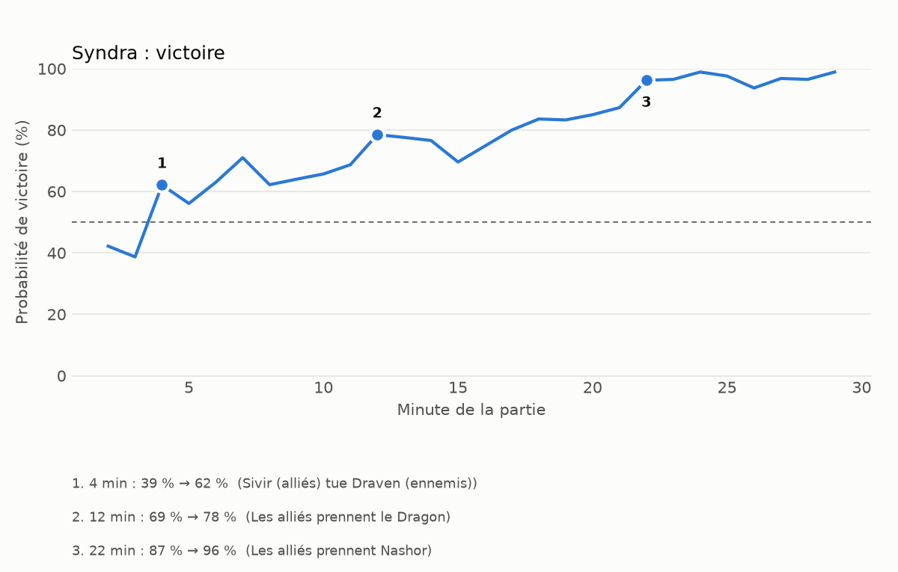
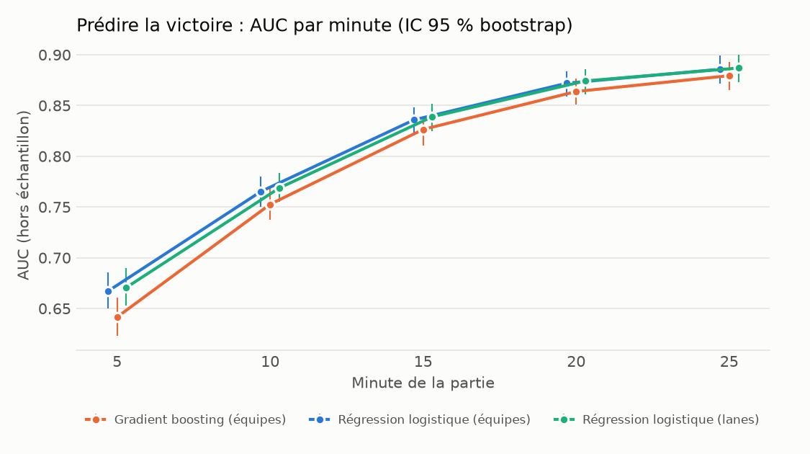
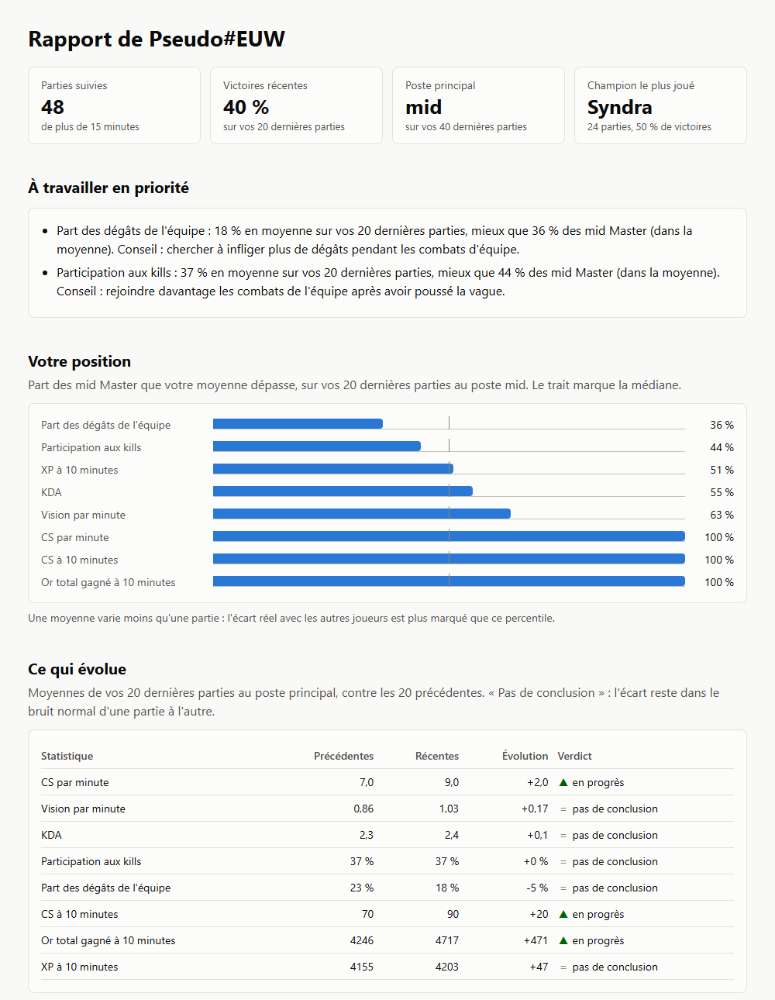

# lol-analyzer


Analyse de parties de League of Legends : collecte via l'API Riot, modèle de
probabilité de victoire (Scikit-learn), moments clés, débrief généré par le code ou
par un LLM local (Ollama), suivi de la progression et rapport HTML. Le tout conteneurisé
avec Docker.



*Exemple : probabilité de victoire de l'équipe minute par minute. Les trois plus gros sauts sont les
« moments clés » du débrief, chacun associé à l'événement de la minute. Un saut n'est pas une cause.*

**Démarrage rapide**, avec une [clé Riot](https://developer.riotgames.com) dans `.env` (voir [Démarrage](#démarrage)) :

```bash
python -m src.run prepare --tier MASTER --max-players 200   # une fois : référence, modèle et repères
python -m src.run report --riot-id "VotrePseudo#EUW"        # puis results/report.html
```

Pour vérifier l'installation, sans clé : `python -m pytest -q`, ou avec Docker
`docker compose build && docker compose run --rm --no-deps app python -m pytest -q`.

> Projet personnel. lol-analyzer isn't endorsed by Riot Games and doesn't reflect the views or opinions
> of Riot Games or anyone officially involved in producing or managing Riot Games properties. Riot
> Games, and all associated properties are trademarks or registered trademarks of Riot Games, Inc.
> Ne publiez ni votre clé API ni de données personnelles de joueurs.

## Ce que fait le projet

1. **Collecte** de parties classées via l'API Riot (vos parties et un échantillon de joueurs Master), avec limitation de débit et reprise des téléchargements.
2. **Modèle de probabilité de victoire** (Scikit-learn) : écarts d'or, d'XP, de CS, d'objectifs entre les deux équipes, minute par minute, sans fuite de données.
3. **Courbe et moments clés** d'une partie : les plus gros sauts de probabilité, associés aux événements de la minute.
4. **Débrief écrit par un LLM local** (Ollama) : le code calcule tout, le modèle ne rédige que le résumé, et chaque texte est contrôlé automatiquement.
5. **Suivi et rapport HTML** : ce qui progresse sur vos dernières parties, vos priorités face aux joueurs de votre poste, et le détail de chaque partie.
6. Le tout dans **Docker** (application + Ollama) avec **CI GitHub** (tests et construction de l'image).

## Résultats

**Modèle de probabilité** : environ 3 200 parties de joueurs Master, collectées du 24 septembre au
31 octobre 2026 (patchs 16.19 à 16.21), régression logistique sur les écarts d'équipe (AUC par minute).

| Minute | 5 | 10 | 15 | 20 | 25 |
|---|---|---|---|---|---|
| Validation croisée par partie | 0,67 | 0,77 | 0,84 | 0,87 | 0,89 |
| Test dans le temps (20 % les plus récentes) | 0,64 | 0,74 | 0,82 | 0,86 | 0,88 |
| Patch 16.20 mis de côté | 0,65 | 0,75 | 0,85 | 0,88 | 0,89 |
| Patch 16.21 mis de côté | 0,68 | 0,77 | 0,83 | 0,87 | 0,89 |



Les écarts entre ces trois mesures sont de l'ordre du bruit de mesure : le modèle tient dans le temps
et d'un patch à l'autre. Il prédit mal le début de partie (AUC 0,65 à 0,68 à 5 minutes) : les sauts de
probabilité avant la 5e minute sont à interpréter avec prudence. Le gradient boosting et le modèle avec
l'écart d'or par lane ne font pas mieux de façon significative : un modèle linéaire suffit.
Réserves : un seul rang (Master), cinq semaines de données et trois patchs (dont un de 43 parties, utilisé
seulement à l'entraînement), tests par patch limités à deux patchs.

**Fidélité des débriefs** : 12 parties, relues à la main (`docs/review.csv`). Une ligne compte comme
fautive si au moins une erreur de chiffre, d'invention ou d'omission a été trouvée.

| Mode (Qwen2.5 7B) | Débriefs avec au moins une erreur |
|---|---|
| Gabarit, sans LLM (référence) | 0 sur 12 |
| Le modèle écrit tout | 6 sur 12 détectés automatiquement ; non relu à la main |
| Hybride v4 (12 parties) | 8 sur 12 |
| Hybride v5 (12 parties) | 3 sur 12 |
| Hybride v5.1 (12 parties) | 2 sur 12 |
| **Hybride v5.2 (39 parties jamais relues)** | **2 sur 39 (5 %, intervalle à 95 % : 1 à 17 %)** |

Réserves : v4 à v5.1 : mesurés sur les mêmes 12 parties, contrôles ajustés au fil des erreurs. v5.2 : mesurée sur 39 parties nouvelles, contrôles figés avant la mesure ; 4 résumés ont été remplacés par le texte du code après 3 échecs du modèle. Un seul relecteur.

**Pistes** : repères par rang (Grandmaster), percentile de votre moyenne parmi les
moyennes de joueurs (voir Limites), choix du modèle par défaut d'après `winprob compare`.

## Démarrage

```bash
python -m venv .venv && source .venv/bin/activate
pip install -r requirements.txt
cp .env.example .env        # puis collez votre clé Riot dans .env
python -m pytest -q         # les tests ne nécessitent pas de clé
```

`requirements.lock` donne les versions exactes utilisées par l'image Docker et par la CI, pour tout reproduire à
l'identique : un modèle enregistré dépend de sa version de scikit-learn.

### En deux commandes

```bash
# une fois : échantillon de référence, modèle de probabilité et repères (200 joueurs, 5 parties : environ 1 h 30)
python -m src.run prepare --tier MASTER --max-players 200 --per-player 5

# à chaque fois que vous voulez faire le point : télécharge, analyse, écrit les débriefs et le rapport
python -m src.run report --riot-id "VotrePseudo#EUW" --count 20
```

Le rapport `results/report.html` tient en un seul fichier, sans ressource externe. Il montre vos tendances, vos
priorités face aux joueurs de votre poste, vos champions, et la courbe et le débrief de chaque partie. Il ne contient
pas votre puuid, mais il contient vos identifiants de parties : à partager en connaissance de cause.



*Le haut du rapport, sur des parties fictives produites par `tests/synthetic.py`.*

- Sans `prepare`, le rapport se limite à vos tendances et à vos champions.
- `report --llm` fait rédiger le résumé de chaque partie par le LLM local. Si Ollama ne répond pas, le débrief est écrit par le code.
- `--no-collect` réutilise les parties déjà téléchargées, sans appeler Riot.
- `--platform kr` choisit un autre serveur : la région de routage s'en déduit.
- `prepare --kind` et `--features` choisissent le modèle (voir section 5), `--label` le nom de l'échantillon.
- `--bench data/gold.csv`, sur les deux commandes, garde des repères par rang dans des fichiers séparés.

Les sections suivantes détaillent chaque étape.

### 1. Collecter des données

```bash
# vos parties classées, de la plus récente à la plus ancienne (--start 100 saute les 100 plus récentes)
python -m src.collect --riot-id "VotrePseudo#EUW" --count 100

# un échantillon de joueurs Master pour entraîner le modèle (500 joueurs, 5 parties chacun)
python -m src.collect --tier MASTER --per-player 5 --max-players 500 --out data/raw/sample

# ou une tranche inférieure, par exemple Gold II
python -m src.collect --tier GOLD --division II --pages 2 --per-player 5

# seulement depuis une date, sur un autre serveur, avec une clé personnelle moins limitée
python -m src.collect --tier MASTER --since 2026-09-24 --platform kr --min-interval 0.1
```

Une partie + sa timeline = 2 requêtes, et la clé de dev autorise ~100 requêtes
par 2 minutes : 1 000 parties prennent environ 40 minutes. Les téléchargements
sont repris là où ils se sont arrêtés.

### 2. Construire le tableau d'entraînement

```bash
python -m src.build_dataset --raw-dir data/raw/sample --out data/dataset.csv
```

Chaque ligne est une partie vue à une minute donnée (écarts d'or, d'XP, de CS,
de kills, de tours, d'objectifs et de wards entre l'équipe bleue et la rouge),
la cible étant `blue_win`.

### 3. Entraîner et évaluer

```bash
python -m src.train --data data/dataset.csv --out results
```

Un modèle par minute (5, 10, 15, 20, 25), évalué hors échantillon avec une
validation croisée **par partie**. Trois modèles sont comparés : régression
logistique sur les écarts d'équipe, gradient boosting, et régression logistique
avec l'écart d'or de chaque lane. Sorties dans `results/` :
`metrics_by_minute.csv`, `auc_by_minute.png` (AUC avec intervalle de confiance
bootstrap), `lane_coefficients.csv` (poids de chaque lane) et `calibration.csv`.

### 4. Repères par poste et comparaison avec vos parties

```bash
python -m src.benchmarks --raw-dir data/raw/sample --me-dir data/raw/me --label Master
```

Affiche, poste par poste, les percentiles des joueurs de l'échantillon (CS/min, vision/min, KDA,
participation aux kills, part des dégâts, CS/or/XP à 10 min) et situe vos propres parties par rapport à eux.
`--label` donne le nom de l'échantillon dans les phrases (« mieux que 80 % des jungle Gold »).

Le débrief compare chaque partie aux joueurs du même poste, et au même champion dès que l'échantillon en contient
30 parties (« Ahri mid Master »). Il ne juge pas un support sur son farm ou sa part des dégâts, et adapte ses conseils
au jungler et au support. Un ancien `data/mid_benchmarks.csv` reste utilisable, pour le mid uniquement.

`collect --riot-id` enregistre votre puuid dans
`data/raw/me/puuid.txt` pour retrouver vos parties. Attention : votre **moyenne** est placée dans la
distribution de parties **individuelles** de la référence ; une moyenne varie moins qu'une partie, donc
l'écart réel avec les autres joueurs est plus marqué que le percentile affiché.

### 5. Courbe de probabilité de victoire et moments clés

```bash
# une ligne par minute (2 à 40) au lieu de 5/10/15/20/25
python -m src.build_dataset --raw-dir data/raw/sample --all-minutes --out data/dataset_all.csv
python -m src.winprob train --data data/dataset_all.csv --time-split 0.2 --patch-holdout
python -m src.winprob analyze --raw-dir data/raw/me --limit 5
```

`train` affiche l'AUC en validation croisée par partie, puis, avec `--time-split 0.2`, l'AUC
d'un modèle entraîné sur les parties les plus anciennes et testé sur les 20 % les plus récentes, et,
avec `--patch-holdout`, l'AUC de chaque patch mis de côté (entraînement sur les autres).
`analyze --skip-existing` ne traite que les parties sans courbe.

`train --calibration` compare, par phase de jeu (2-5, 6-10, 11-15, 16-25 et 26-40 minutes), la probabilité
annoncée au taux de victoire réel, hors échantillon, et écrit `results/curve_calibration.csv`. L'AUC dit si
le modèle classe bien les parties ; seule la calibration dit si « 62 % » veut vraiment dire 62 %.

Chaque moment clé indique ses `ecarts` : ce qui a réellement bougé sur la minute (or, XP, CS, kills, objectifs),
vu de votre équipe. Ce sont des faits de la partie, sans aucun modèle.

**Choisir le modèle.** Trois types de modèle et deux jeux de variables sont disponibles (`train --kind` et
`--features`). `lineaire` reste le choix par défaut, car c'est lui qui est mesuré plus haut :

| `--kind` | Poids de chaque variable | Intérêt |
|---|---|---|
| `lineaire` | évolue en ligne droite avec la minute | référence |
| `phases` | un poids à 5, 10, 15, 25 et 40 minutes, interpolé entre eux | le début de partie n'hérite pas de la tendance de la fin |
| `monotone` | comme `phases`, sans poids négatif | un avantage ne fait jamais baisser la probabilité |

`--features etendu` ajoute les inhibiteurs, le Dragon Ancien, l'âme de dragon, Atakhan, les kills des 2 dernières
minutes et la part de l'or total : reconstruisez le jeu de données avec `build_dataset` pour en disposer.

```bash
python -m src.winprob compare --data data/dataset_all.csv --time-split 0.2  # compare tous ces modèles
python -m src.winprob learning-curve --data data/dataset_all.csv            # faut-il collecter plus de parties ?
```

`compare` donne, au global et par phase de jeu, l'AUC, la log-loss, l'écart de calibration et le gain de log-loss
sur le modèle `lineaire`. Ce gain est mesuré sur les mêmes lignes, avec un intervalle à 95 % rééchantillonné par
partie : si l'intervalle contient 0, rien ne sépare les deux modèles.

**Part de chaque famille.** Avec un modèle sans poids négatif (`monotone`), chaque moment clé indique aussi
`contributions` : les points du saut répartis entre `ressources`, `combats`, `objectifs` et `vision`. Avec une
régression libre, cette répartition n'est pas affichée. Kills et Nashor y reçoivent en effet des poids négatifs, car
ils sont très corrélés à l'or : sur le modèle archivé dans l'historique du dépôt, prendre Nashor s'afficherait comme
« objectifs -8 points ». La répartition dit ce qui a fait bouger la prédiction, pas ce qui a causé la victoire.

Un seul modèle (régression logistique) sert pour toutes les minutes : le poids de
chaque variable évolue avec le temps. Pour chaque partie analysée, `results/curves/`
contient un graphique (probabilité de victoire minute par minute, vue de votre
équipe) et un JSON avec les **moments clés** : les plus gros sauts de probabilité,
associés aux événements de la minute (objectifs, tours, kills). Ce JSON est
l'entrée du débrief par LLM : le modèle de langage ne lit jamais la timeline brute.

Avertissement : un saut de probabilité n'est pas une cause. Il signale qu'un
écart d'or, d'XP ou d'objectifs a bougé ; l'événement associé est le plus
plausible, pas prouvé.

### 6. Débrief par un LLM local (Ollama)

```bash
ollama pull qwen2.5:7b                          # une seule fois (environ 4,7 Go)
python -m src.winprob analyze --limit 5         # courbes et moments clés
python -m src.debrief --limit 1 --dry-run       # affiche ce que le modèle recevra
python -m src.debrief --limit 3                 # mode hybride (par défaut)
python -m src.debrief --limit 3 --mode template # sans modèle de langage (référence)
python -m src.debrief --limit 3 --mode llm      # le modèle écrit tout le débrief
```

**Le code analyse, le modèle rédige.** Une première version donnait au modèle des
chiffres bruts à interpréter : il mélangeait les chiffres, attribuait au joueur la
probabilité de l'équipe et inventait des explications. Trois modes permettent de
comparer leur fidélité :

| Mode | Qui écrit quoi | Rôle du contrôle |
|---|---|---|
| `template` | le code écrit tout (aucun LLM) | référence |
| `hybrid` (défaut) | le code écrit moments clés, points forts, axes de progrès, tendance ; le modèle n'écrit que le résumé (3 phrases) | accepte, fait réessayer ou remplace le résumé |
| `llm` | le modèle écrit tout | signale les problèmes |

**Mode hybride.** Le modèle ne voit que la partie et la forme de la courbe
(« 9e minute : de 54 % à 44 % »), jamais les événements ni les autres joueurs : il ne
peut donc se tromper ni de cause ni de champion. Son résumé passe le contrôle ; en cas
d'échec il reçoit la liste de ses erreurs et un autre tirage (graine différente), jusqu'à
3 tentatives (`--attempts`). Si aucune ne passe, le résumé écrit par le code le remplace
et la fiche de relecture le signale.

**Version 5 (maximum, minimum, valeur finale).** La relecture manuelle avait montré que 8
résumés hybrides sur 12 (version 4) contenaient une erreur invisible au contrôle automatique :
le modèle ne connaissait ni la minute du maximum et du minimum, ni la valeur finale, et les
devinait (« pic à 92 % » alors que le maximum était 99 %). La phrase de courbe indique donc
maintenant le maximum, le minimum et la valeur finale avec leur minute, et un contrôle compare
chaque « maximum », « pic », « minimum », « le plus bas », « fini à » aux vraies valeurs, refuse un
0 % ou un 99 % placé à la mauvaise minute, une même minute citée avec deux valeurs, et les
affirmations invérifiables (« jusqu'à la fin », « plus brusquement »). Mesures : voir
`docs/review.csv` (lignes `hybride v4`, `v5`, `v5.1`). Les versions 5.1 et 5.2 ajoutent des
contrôles écrits à partir des erreurs restantes : comme ils sont réglés sur les mêmes 12 parties,
leur score est optimiste et doit être confirmé sur des parties nouvelles.

**Version 5.3 (non mesurée sur des parties nouvelles).** Écrite à partir des erreurs et des remarques de la relecture
de la v5.2 : une valeur citée à une minute doit être celle que les faits y placent (« passant à 86 % à la 30e » alors
que 86 % est la valeur d'avant le saut), une transition doit être citée à la minute du saut, et le résumé ne peut ni
citer un nombre qu'il n'a jamais vu, ni affirmer ce qui se passe entre deux minutes (« reste à », « se stabilise »,
« jusqu'à la 22e »). Rejoué sur les résumés v5 et v5.1 relus à la main, ce contrôle détecte les 5 erreurs relevées, mais
refuse aussi 7 résumés sur 18 jugés sans erreur, surtout à cause de ces formulations : il y aura sans doute plus de
reprises, voire de replis sur le texte du code. Pour rejouer le contrôle sur des débriefs déjà écrits, sans LLM :

```bash
python -m src.debrief --recheck results/debriefs --review docs/review.csv
```

Chaque moment clé indique aussi les écarts sur la minute, la part de chaque famille si le modèle le permet (voir
section 5), et signale les premières minutes, où l'estimation est peu fiable. Le résumé du modèle n'utilise rien de cela.

**Contrôle automatique** : nombres absents des faits, pourcentages qui n'existent pas
comme pourcentages, transitions « de A % à B % » qui mélangent deux sauts, moments clés
omis, champions cités à la mauvaise minute, minutes écrites en lettres, liste de mots anglais connus,
caractères chinois, formulations causales (« grâce à », « suite à »...), sections écrites
sans données, résumé de plus de 3 phrases. Il ne vérifie ni le sens des phrases, ni qui a
tué qui : relisez chaque débrief.

**Mesure de fidélité.** Chaque exécution met à jour `results/debriefs/review.csv` (copie des mesures : `docs/review.csv` ; une
ligne par débrief et par mode, le mode hybride étant étiqueté `hybride v5.3`). Remplissez à
la main `erreurs_chiffres`, `inventions` et `omissions` : vos annotations sont conservées
quand vous relancez. Le nombre d'erreurs par débrief permet de comparer les modes et les
modèles (`--model llama3.1:8b`). Fermez le fichier dans Excel avant de relancer.

### 7. Suivi et rapport

```bash
python -m src.progress --raw-dir data/raw/me --window 20   # dans le terminal
python -m src.report --raw-dir data/raw/me                 # results/report.html
```

Compare vos 20 dernières parties aux 20 précédentes, au poste que vous jouez le plus. Une évolution n'est annoncée que si
elle sort du bruit normal d'une partie à l'autre : la marge tient compte des 8 statistiques regardées en même temps, pour
limiter les fausses alertes. Les priorités sont les deux statistiques les plus basses face aux joueurs de votre poste.

### Avec Docker

Deux services : `app` (le code) et `ollama` (le LLM local). Les dossiers `data/` et
`results/` sont montés depuis votre machine, donc rien n'est perdu quand le conteneur s'arrête.

```bash
docker compose build                                   # construit l'image de l'application
docker compose run --rm --no-deps app python -m pytest -q  # les tests, sans démarrer Ollama
docker compose up -d ollama                            # démarre le LLM local
docker compose exec ollama ollama pull qwen2.5:7b      # télécharge le modèle (une fois, ~4,7 Go)
docker compose run --rm app python -m src.debrief --limit 3
docker compose run --rm app python -m src.run report --riot-id "VotrePseudo#EUW" --llm  # toute la chaîne
docker compose down                                    # arrête les services
```

Avec un GPU NVIDIA (Docker Desktop + pilote NVIDIA), démarrez Ollama ainsi, puis vérifiez avec
`docker compose exec ollama ollama ps` que la colonne PROCESSOR indique `100% GPU` :

```bash
docker compose -f docker-compose.yml -f docker-compose.gpu.yml up -d ollama
```

Le conteneur `app` joint Ollama par son nom (`OLLAMA_HOST=http://ollama:11434`) : aucun port
n'est publié, ce qui évite tout conflit avec un Ollama déjà lancé sur votre machine.

## Rigueur méthodologique

- Validation croisée **par partie** (jamais deux minutes d'une même partie des deux côtés),
  complétée par un test dans le temps et un test par patch.
- AUC avec intervalle de confiance bootstrap, log-loss et calibration, pas seulement la précision.
- Aucune fuite de données : à la minute N, seules les informations antérieures à N sont utilisées.
- Modèles comparés sur les mêmes lignes, avec un gain de log-loss et un intervalle rééchantillonnés par partie
  (`winprob compare`), et calibration mesurée par phase de jeu pour le modèle de la courbe.
- Débriefs : le code calcule, le modèle ne rédige que le résumé, chaque texte est contrôlé, et la
  fidélité est mesurée par relecture manuelle (`docs/review.csv`). Un nouveau contrôle peut être rejoué sur les
  résumés déjà relus, sans LLM (`debrief --recheck`).
- Tests : toute la chaîne tourne de bout en bout sur des parties synthétiques au format Riot. La CI vérifie aussi les
  versions figées, les dernières versions disponibles et l'image Docker.

## Limites connues

- Les modèles de minutes tardives n'utilisent que les parties assez longues
  (biais de survie) : comparer les minutes entre elles demande de la prudence.
- Les différences de quelques points d'AUC entre les trois modèles restent dans les intervalles de
  confiance : à cette taille d'échantillon, rien ne justifie un modèle plus complexe qu'une régression
  logistique.
- Le modèle prédit mal le début de partie (AUC de 0,65 à 0,68 à 5 minutes) : les sauts de
  probabilité avant la 5e minute sont peu fiables.
- Les poids du modèle « lanes » sont des corrélations, pas des effets causaux :
  les lanes d'une même équipe sont corrélées entre elles.
- Données issues d'un seul niveau de jeu (Master) : ne pas généraliser aux autres rangs.
- `league-v4/entries` ne couvre que IRON à DIAMOND ; Master et au-delà utilisent
  d'autres endpoints.
- La clé de développement expire toutes les 24 h.
- Fidélité des débriefs mesurée sur 51 parties et par un seul relecteur ; le modèle de 7 milliards de
  paramètres (Qwen2.5 7B) échoue encore 3 fois de suite sur environ 10 % des parties, qui reçoivent alors
  le texte écrit par le code.
- Les repères comparent une moyenne à des parties individuelles (voir plus haut). Un champion n'a ses propres repères
  qu'à partir de 30 parties, et la tendance habituelle mélange tous vos champions : un percentile bas n'est pas
  forcément un défaut. Les conseils par poste sont écrits à la main, et leur effet sur le jeu n'est pas mesuré.
- Les parties d'entraînement viennent de cinq semaines et de trois patchs : la validité sur une autre
  saison n'est pas testée.
- Le suivi compare des moyennes sans tenir compte des champions joués ni des adversaires : une évolution peut venir d'un
  changement de champion plutôt que d'un progrès.
- La chaîne complète est testée sur des parties synthétiques (`tests/synthetic.py`) : leur format imite celui de Riot, mais
  seules de vraies parties valident les champs rares, comme l'âme de dragon.

## Licence

MIT, voir `LICENSE`.
